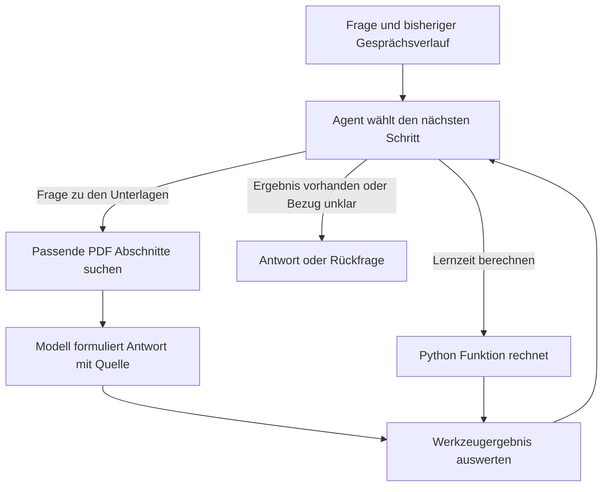

# LangChain Schritt für Schritt lernen

Vier deutschsprachige Jupyter Notebooks zeigen, wie ein kleiner Modul-Assistent entsteht. Er beantwortet Fragen zu Unterlagen über Bitcoin und Open Banking. Jede neue Fähigkeit wird mit Text und ausführbarem Code erklärt.

## Für wen ist die Reihe gedacht?

Für Menschen mit ersten Python-Grundkenntnissen. Vorkenntnisse zu Sprachmodellen oder LangChain werden nicht benötigt.

Ein **Sprachmodell**, auch LLM genannt, verarbeitet Nachrichten und erzeugt Antworten. Diese können falsch sein. **LangChain** stellt Python-Bausteine bereit, mit denen Fragen vorbereitet, Modelle aufgerufen und Antworten weiterverarbeitet werden.

## Die vier Notebooks

| Notebook | Inhalt |
|---|---|
| [01 · Eine erste Frage beantworten](notebooks/01_hello_langchain_prompts.ipynb) | Eine Frage mit Unterlagentext an das BFH-Modell senden. Antwort und Quelle in festen Feldern ausgeben. |
| [02 · Gesprächsverlauf verwenden](notebooks/02_memory.ipynb) | Frühere Nachrichten erneut mitgeben. Vollständigen Verlauf, Nachrichtenfenster und Zusammenfassung vergleichen. |
| [03 · Textstellen suchen](notebooks/03_rag.ipynb) | Passende Abschnitte in zwei PDFs finden und als Grundlage für eine Antwort verwenden. |
| [04 · Werkzeuge verwenden](notebooks/04_agents_evaluation.ipynb) | Dokumentensuche und Rechner verbinden. Antworten, Quellen und Werkzeugaufrufe beurteilen. |

Mit Notebook 01 beginnen und die Zellen von oben nach unten ausführen. Vor jeder Codezelle steht eine Erklärung. Die Beispiele, absichtlichen Fehler und Übungen helfen beim eigenen Ausprobieren.

Jedes Notebook kann technisch einzeln gestartet werden. Der **Kernel** ist das laufende Python-Programm im Hintergrund. Nach einem Neustart müssen die Zellen erneut von oben ausgeführt werden.

## Der Modul-Assistent im Überblick

Die vier Notebooks bauen diesen Assistenten Schritt für Schritt auf. Die Grafik zeigt den grundlegenden Ablauf des fertigen Assistenten.



Am Ende steht ein kleiner Assistent, der Unterlagen nutzen und ein Rechenwerkzeug aufrufen kann. Seine Antworten werden anhand von Inhalt, Quelle und tatsächlich verwendeten Werkzeugen beurteilt.

## Start unter Windows

Das Projekt unterstützt Python **3.12 und 3.13**. Alle Befehle werden im Projektordner ausgeführt.

**Einfacher Start:** `setup.bat` doppelt anklicken. Das Skript richtet die Projektumgebung ein und öffnet JupyterLab.

**Manuelle Einrichtung mit Python 3.13 in PowerShell:**

```powershell
py -3.13 -m venv .venv
.\.venv\Scripts\python.exe -m pip install -r requirements.txt
.\.venv\Scripts\python.exe -m pip install -e .
.\.venv\Scripts\python.exe -m jupyterlab notebooks
```

Wenn die Umgebung bereits eingerichtet ist, genügt beim nächsten Mal der letzte Befehl. In JupyterLab `01_hello_langchain_prompts.ipynb` öffnen und den Kernel der Projektumgebung verwenden.

Für macOS und Linux gibt es `bash setup.sh`. Diese Betriebssysteme wurden hier nicht getestet.

## BFH API einrichten

Alle Modellantworten kommen über die BFH-API. Das ist die Schnittstelle zum BFH-Dienst. Auch die **Embeddings** kommen von dort: Zahlenlisten, mit denen Texte verglichen werden.

Dafür werden eine Internetverbindung und ein persönlicher BFH-Schlüssel benötigt. Das Einlesen der PDFs und die Rechenfunktion laufen auf dem eigenen Rechner.

Falls noch keine `.env` vorhanden ist, `.env.example` als `.env` kopieren. Dort die persönlichen Einstellungen eintragen:

```dotenv
BFH_API_KEY=dein_persoenlicher_schluessel
BFH_BASE_URL=https://inference.proxy.ti.bfh.ch/v1
BFH_CHAT_MODEL=qwen3.8-27b
BFH_EMBEDDING_MODEL=embeddinggemma:300m
```

Der Schlüssel gehört ausschliesslich in `.env`. Diese Datei ist von Git ausgeschlossen. Die aktuelle Modellverfügbarkeit steht in der [BFH-Dokumentation](https://infra.pages.ti.bfh.ch/mlmp/src/llm/).

`ChatOpenAI` ist hier der Name des LangChain-Adapters für die kompatible BFH-Schnittstelle. Die eingestellte Adresse legt fest, wohin die Anfrage gesendet wird. Für Embeddings und Antworten werden die verwendeten Textabschnitte an den BFH-Dienst übertragen.

Nach Änderungen an den Einstellungen den Kernel neu starten und die Zellen von oben ausführen. Ein fehlender Schlüssel oder eine fehlgeschlagene Verbindung wird als Fehler angezeigt.

## Verwendete Unterlagen

- `data/modulunterlagen/Eigenschaften-Bitcoin.pdf`: eine Seite.
- `data/modulunterlagen/Open Banking_Zusammenfassung.pdf`: vier Seiten.

Notebook 01 beginnt mit der Bitcoin-Seite. Ab Notebook 03 werden beide PDFs durchsucht. Die Aufgaben-PDFs im übergeordneten Ordner `data/` beschreiben den Projektauftrag und gehören nicht zu den durchsuchten Fachunterlagen.

Eine Quellenangabe zeigt, wo ein Beleg liegen soll. Ob die Aussage tatsächlich dort steht, muss anhand der Textstelle beurteilt werden.

## Dokumentation

- [Architektur des Modul-Assistenten](docs/Architektur.md)

- [LangChain-Dokumentation](https://docs.langchain.com/oss/python/langchain/overview)
- [BFH-Inference-Dokumentation](https://infra.pages.ti.bfh.ch/mlmp/src/llm/)
